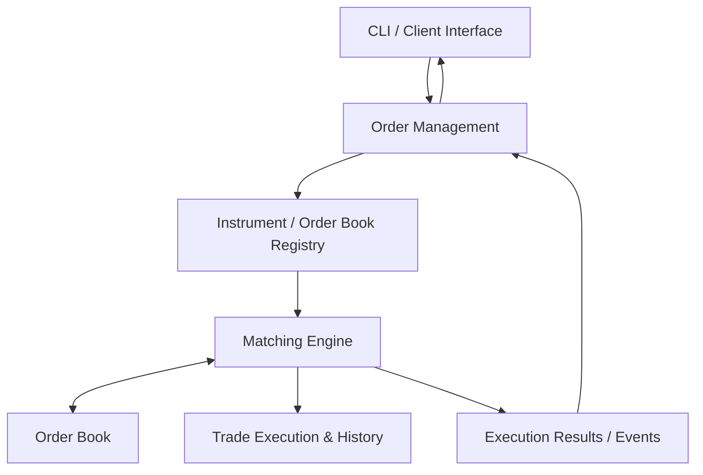
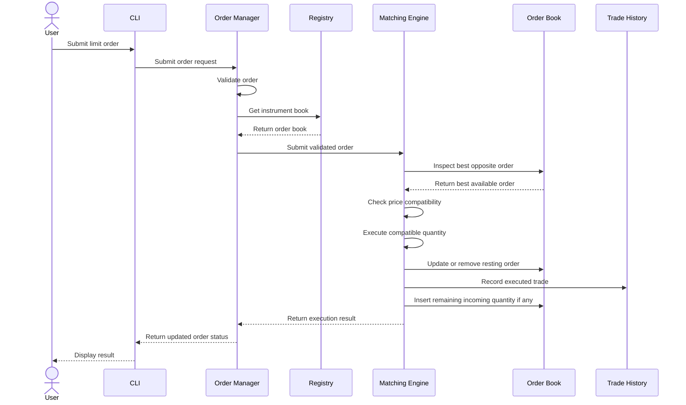

# MarketFlow – System Architecture and Design

**Project:** MarketFlow  
**Version:** 1.0  
**Architecture:** Modular Monolith  
**Language:** C++

## 1. Architectural Overview

MarketFlow will follow a modular monolithic architecture.

All application components will execute within one process, while their responsibilities are separated into independent modules.

The architecture prioritises:

- Clear separation of concerns.
- Efficient order-book operations.
- Predictable matching behaviour.
- Testable business logic.
- Minimal unnecessary dependencies.
- Future support for concurrent processing and persistence.

## 2. High-Level Architecture



The diagram represents logical responsibilities. The matching engine operates on an instrument's order book and produces execution results and trade records.

## 3. Component Responsibilities

### 3.1 Domain Models

**Location:** `include/models/`

Defines the core data structures used throughout the application.

Main models:

- `Order`
- `Trade`
- `Instrument`

The models should primarily represent domain data and enforce basic invariants. They should not contain unnecessary application-level dependencies.

### 3.2 Common Types

**Location:** `include/common/`

Defines shared types and enumerations.

Examples:

- `OrderId`
- `TradeId`
- `Price`
- `Quantity`
- `InstrumentId`
- `OrderSide`
- `OrderStatus`

Use explicit integer types for financial prices and quantities.

Initial type decisions:

- Price: signed 64-bit integer representing price ticks.
- Quantity: unsigned 64-bit integer.
- Order ID: unsigned 64-bit integer.
- Trade ID: unsigned 64-bit integer.
- Instrument ID: string.

Input validation must prevent invalid values and arithmetic overflow.

### 3.3 Order Management

**Location:** `include/order_management/`

Responsibilities:

- Receive new order requests.
- Validate order fields.
- Check duplicate order identifiers.
- Obtain the correct instrument order book.
- Submit valid orders to the matching engine.
- Process cancellation requests.
- Coordinate order lifecycle updates.

Order management should not implement the price-time matching algorithm itself.

### 3.4 Order Book

**Location:** `include/order_book/`

Maintains outstanding buy and sell orders for one financial instrument.

Responsibilities:

- Maintain bid and ask sides.
- Organise orders by price.
- Preserve FIFO ordering within each price level.
- Add resting orders.
- Remove fully executed orders.
- Support order cancellation.
- Provide access to the best bid and ask.

Proposed data structures:

**Bid side:**

`std::map<Price, std::list<Order>, std::greater<Price>>`

**Ask side:**

`std::map<Price, std::list<Order>, std::less<Price>>`

**Order lookup:**

`std::unordered_map<OrderId, OrderLocation>`

The `OrderLocation` structure will identify the order's side, price level and position in the corresponding list.

This allows cancellation without scanning every order in the book.

The implementation must carefully maintain lookup entries when orders are inserted, partially filled, fully executed or cancelled.

### 3.5 Instrument / Order Book Registry

**Location:** `include/order_management/` initially.

Maintains the association between instrument identifiers and their order books.

Proposed data structure:

`std::unordered_map<InstrumentId, OrderBook>`

Each instrument receives an independent order book.

For example:

- AAPL → AAPL order book.
- MSFT → MSFT order book.
- TSLA → TSLA order book.

This ensures orders for different instruments cannot interact.

The registry may be extracted into a separate module if its responsibilities grow.

### 3.6 Matching Engine

**Location:** `include/matching/`

This is the central component of MarketFlow.

Responsibilities:

- Receive validated incoming orders.
- Identify the opposite side of the order book.
- Check price compatibility.
- Apply price-time priority.
- Execute compatible quantities.
- Update incoming and resting orders.
- Generate trade records.
- Insert any unexecuted remainder into the order book.

The matching engine must not accept invalid orders directly from external clients. Order management is responsible for validation.

### 3.7 Trade Execution and History

**Location:** `include/models/` and `src/matching/` initially.

Responsibilities:

- Create trade records for successful matches.
- Generate unique trade IDs.
- Record the instrument, execution price and quantity.
- Record the maker (resting order) and taker (incoming order).
- Maintain in-memory trade history.

A trade record should contain:

- Trade ID.
- Instrument ID.
- Maker order ID.
- Taker order ID.
- Execution price.
- Executed quantity.
- Execution sequence number.

The execution sequence number provides deterministic ordering in the initial simulation.

### 3.8 Market Data and Event Processing

**Location:** `include/market_data/`

The module will provide a structured way to represent execution-related events.

Initial event types may include:

- OrderAccepted
- OrderRejected
- OrderPartiallyFilled
- OrderFilled
- OrderCancelled
- TradeExecuted
- OrderBookUpdated

For the MVP, events can be returned as execution results or stored in memory. An external message broker or asynchronous event-distribution system is outside the initial scope.

### 3.9 Command-Line Interface

**Location:** `src/main.cpp`

Provides a basic interface to:

- Submit buy and sell orders.
- Cancel active orders.
- Display order-book depth.
- Display trade history.
- View order details and status.

The CLI must delegate business operations to the order-management layer rather than implementing matching logic itself.

## 4. Order Submission and Matching Flow

The following sequence describes how a new order is processed.



If validation fails, the order is rejected before it reaches the matching engine.

If no compatible resting order exists, the incoming order is inserted into its own side of the order book.

## 5. Matching Algorithm

### 5.1 Buy Order Processing

For an incoming buy order:

1. Inspect the lowest-priced sell order.
2. Compare its price with the incoming buy limit price.
3. If the best ask exceeds the buy limit, stop matching.
4. Otherwise, execute the smaller remaining quantity.
5. Use the resting sell order's price as the trade price.
6. Update both orders' executed and remaining quantities.
7. Remove a fully filled resting order.
8. Continue until the incoming order is filled or no compatible sell order remains.
9. Insert any remaining incoming quantity into the bid book.

Matching condition:

`Best Ask Price <= Incoming Buy Limit Price`

### 5.2 Sell Order Processing

For an incoming sell order:

1. Inspect the highest-priced buy order.
2. Compare its price with the incoming sell limit price.
3. If the best bid is below the sell limit, stop matching.
4. Otherwise, execute the smaller remaining quantity.
5. Use the resting buy order's price as the trade price.
6. Update both orders' executed and remaining quantities.
7. Remove a fully filled resting order.
8. Continue until the incoming order is filled or no compatible buy order remains.
9. Insert any remaining incoming quantity into the ask book.

Matching condition:

`Best Bid Price >= Incoming Sell Limit Price`

### 5.3 Execution Quantity

For each match:

`Execution Quantity = min(Buy Remaining Quantity, Sell Remaining Quantity)`

After execution:

`Remaining Quantity = Previous Remaining Quantity - Execution Quantity`

`Executed Quantity = Previous Executed Quantity + Execution Quantity`

All updates must preserve order-book consistency.

## 6. Order-Book Data Structure Design

The order book uses a two-level organisation.

```text
OrderBook
│
├── Bids (highest price first)
│   ├── Price Level: 19000
│   │   ├── Order A (earlier)
│   │   └── Order B (later)
│   ├── Price Level: 18900
│   │   └── Order C
│   └── Price Level: 18800
│       └── Order D
│
├── Asks (lowest price first)
│   ├── Price Level: 19100
│   │   └── Order E
│   └── Price Level: 19200
│       ├── Order F (earlier)
│       └── Order G (later)
│
└── Order ID Lookup
    ├── Order A → Location
    ├── Order B → Location
    └── ...
```

### Why these structures?

**std::map**

Maintains sorted price levels and provides efficient access to the best available price.

**std::list**

Preserves FIFO order and supports efficient removal when an iterator is available.

**std::unordered_map**

Provides efficient average-case lookup of orders by their unique identifiers.

The lookup index must not contain stale iterators. Every removal path must update both the price-level structure and the lookup index.

## 7. Complexity Considerations

Let:

- `P` = number of distinct price levels.
- `N` = number of active orders.
- `K` = number of executions produced by one incoming order.

Expected operation characteristics:

| Operation                            | Expected complexity                 |
| ------------------------------------ | ----------------------------------- |
| Access best bid/ask                  | O(1) for the first map element      |
| Insert a price level                 | O(log P)                            |
| Find an existing price level         | O(log P)                            |
| Append order to existing price level | O(1)                                |
| Find order by ID                     | O(1) average                        |
| Remove order using stored iterator   | O(1)                                |
| Match K resting orders               | O(K), excluding price-level changes |

These are design expectations, not benchmark results. Actual performance will be measured after implementation.

## 8. Important Design Invariants

The following invariants must always hold:

1. Every active order belongs to exactly one instrument and one side of its order book.
2. An order cannot exist on both bid and ask sides.
3. Remaining quantity plus executed quantity equals original quantity.
4. Remaining quantity cannot exceed original quantity.
5. Fully filled and cancelled orders cannot remain in the active book.
6. No trade can violate the incoming order's limit price.
7. Every trade must involve two orders for the same instrument.
8. A trade's quantity cannot exceed either participating order's remaining quantity before execution.
9. Orders at the same price must preserve submission priority.
10. The order lookup index must remain consistent with the order-book structures.

## 9. Concurrency Strategy

The initial MVP will use single-threaded order processing.

This simplifies correctness and ensures deterministic matching behaviour while the core algorithm is being developed.

A future extension may process independent instrument books concurrently.

For example:

- AAPL book → Worker 1.
- MSFT book → Worker 2.
- TSLA book → Worker 3.

Each individual instrument's order stream must preserve its defined processing order.

We will not introduce shared mutable order-book access or concurrent matching before the single-threaded implementation is correct and tested.

## 10. Error Handling

The application must handle:

- Duplicate order identifiers.
- Unknown instruments.
- Invalid prices.
- Zero quantities.
- Unknown order IDs during cancellation.
- Cancellation of filled or already cancelled orders.
- Integer overflow risks.
- Invalid order-side values.

Errors should be represented clearly, without silently corrupting order-book state.

## 11. Proposed Source Structure

```text
MarketFlow/
│
├── include/
│   ├── common/
│   │   └── Types.hpp
│   ├── models/
│   │   ├── Order.hpp
│   │   ├── Trade.hpp
│   │   └── Instrument.hpp
│   ├── order_management/
│   │   └── OrderManager.hpp
│   ├── order_book/
│   │   └── OrderBook.hpp
│   ├── matching/
│   │   └── MatchingEngine.hpp
│   └── market_data/
│       └── MarketDataPublisher.hpp
│
├── src/
│   ├── main.cpp
│   ├── models/
│   ├── order_management/
│   ├── order_book/
│   ├── matching/
│   └── market_data/
│
├── tests/
├── benchmarks/
├── docs/
│   ├── requirements.md
│   └── architecture.md
│
├── scripts/
├── CMakeLists.txt
├── README.md
├── .gitignore
└── LICENSE
```

This is the proposed structure. Files will be added as their corresponding components are implemented.

## 12. Future Architecture Extensions

Potential extensions after the MVP:

- PostgreSQL persistence.
- Boost.Asio-based TCP communication.
- Event-driven market data distribution.
- Concurrent processing of independent instruments.
- Google Benchmark-based performance evaluation.
- Profiling and memory optimisation.

These extensions must preserve the core matching rules and order-book invariants.

---
